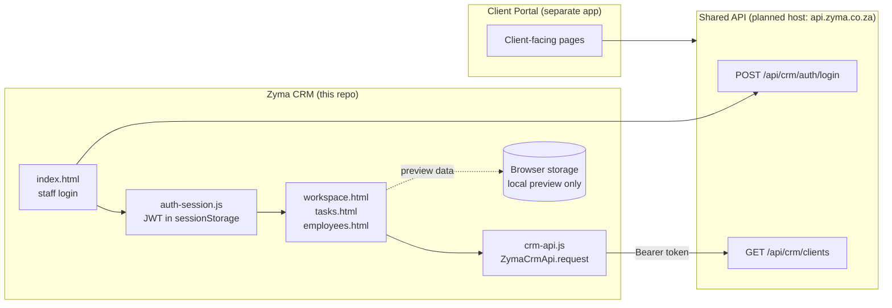
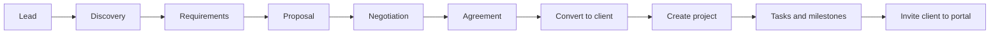

<div align="center">
  <h1>Zyma CRM</h1>
  <p><strong>Know every lead. Know where every project stands.</strong></p>
  <p>The internal CRM for Zyma Systems staff and Super Admin: leads, clients, projects, tasks and communications in one workspace, built to connect to a shared ASP.NET Core API.</p>

  
  
  
</div>

---

## Overview

Zyma CRM is about two things: keeping a clear record of every relationship from first lead to delivered project, and keeping that record internal. It is a standalone frontend for Zyma Systems staff and the Super Admin. It is separate from the client-facing Client Portal, and the two share data only through the planned ASP.NET Core API.

A record moves through one path: a **lead** is progressed through discovery, requirements, proposal, negotiation and agreement, converted to a **client**, linked to a **project**, and broken down into **tasks and milestones**. Meetings, communications and follow-ups are recorded against the relevant lead, client or project along the way.

> **Current status:** staff sign-in and the `GET /clients` route are connected to the API. Everything else in the workspace still runs on browser-local preview storage. See [Integration status](#integration-status) for exactly what is and is not API-backed.

## What's inside

| Page | Role |
| --- | --- |
| `index.html` | Staff login |
| `forgot-password.html` | Request a password recovery |
| `reset-password.html` | Token-based password reset |
| `activate-account.html` | Accept an employee invitation and set a password |
| `invite-client.html` | Invite a client contact to the Client Portal |
| `workspace.html` | Dashboard, leads, meetings, clients, contacts, projects, tasks, communications, reports and settings |
| `tasks.html` | Project picker, project-specific task board and list, and milestone management |
| `employees.html` | Employee directory and access administration (Super Admin) |

| Script | Role |
| --- | --- |
| `auth-session.js` | Guards the workspace, tasks and employee pages against unauthenticated navigation and checks JWT expiry |
| `crm-api.js` | Exposes `window.ZymaCrmApi.request(path, options)`, which sends the Bearer token to CRM API routes and returns the user to sign-in after a `401` |
| `login.js` | Staff sign-in |
| `current-user.js` / `workspace-access.js` | Current user and workspace access rules |
| `app.js`, `tasks.js`, `employees.js`, `invite-client.js` | Page logic for the workspace, task board, employee directory and client invitations |

## How it fits together



The CRM and the Client Portal never talk to each other directly. The API decides what each audience can see: staff see CRM records, and a client sees only the projects and support records the API authorizes for them.

## Key workflows

1. **Add a lead** and progress it through discovery, requirements, proposal, negotiation and agreement.
2. **Convert** a qualified lead to a client record.
3. **Confirm the client** record before creating a project.
4. **Create a project** linked to that client. The project reference can be generated automatically.
5. **Open the project** and select **Manage tasks & milestones** to enter its task workspace.
6. **Add tasks and milestones**, with owners, due dates, priorities and statuses.
7. **Record meetings, communications, follow-ups and outcomes** against the relevant lead, client or project.
8. **Invite the client contact** to the Client Portal. Authorized staff only; the portal shows just what the API authorizes for that client.



## Authentication

- Staff sign-in calls `POST https://api.zyma.co.za/api/crm/auth/login`.
- The returned JWT is held in `sessionStorage` for the current tab session, never `localStorage`.
- `auth-session.js` redirects unauthenticated visitors away from the internal pages and checks JWT expiry.
- `crm-api.js` attaches the Bearer token to API calls and returns the user to sign-in after a `401`.
- Browser sign-in requires the API to allow CORS from `https://crm.zyma.co.za`.
- Do not enable a local preview or demo login as a fallback in production.

## Integration status

| Area | Status |
| --- | --- |
| Staff sign-in | Connected to the API |
| `GET /clients` (public URL `/api/crm/clients`) | Connected, protected by Bearer token |
| Leads, contacts, projects, tasks, milestones, meetings, communications | Browser-local preview only |
| Client create, update and delete | Not API-backed yet |
| Employee administration and invitations | Not API-backed yet |
| Password recovery and reset | Not API-backed yet |
| `apiMode` | Keep disabled until record loading, writes, authentication and CSRF behavior are implemented and tested |

Each remaining area needs implemented backend routes and DTOs, then explicit wiring and tests, before it should be described as API-backed.

## Run the frontend

The CRM is plain static HTML, CSS and JavaScript with no build step, so any local static file server works. The repository includes a `CNAME` file for custom-domain hosting (`crm.zyma.co.za`).

1. Serve the repository folder with a static server of your choice.
2. Open `index.html` and sign in. Sign-in needs the API reachable and CORS enabled for your origin.
3. Records you create in the workspace are saved to browser storage.

**Local preview storage**

- CRM records are kept in browser storage until API integration is complete.
- A new storage namespace starts with an empty workspace, so older pre-populated sample records are not loaded.
- Browser storage is not shared between users or devices, and it is not secure enough for production client data. Do not enter real client data while running in preview mode.

## Shared API

Default API base: `https://api.zyma.co.za`. The host is a planned integration target and must be configured when the API is deployed. The API adapter and authenticated bootstrap are not complete.

For the proposed API contracts and security requirements, see:

- [`BACKEND-INTEGRATION.md`](BACKEND-INTEGRATION.md)
- [`AUTHENTICATION-SETUP.md`](AUTHENTICATION-SETUP.md)
- [`SHARED-API-ARCHITECTURE.md`](SHARED-API-ARCHITECTURE.md)

## Known limits

- Most CRM data lives only in the current browser, so it is lost if site data is cleared and is invisible to other staff.
- Only `GET /clients` is protected and API-backed today.
- The JWT lives in `sessionStorage`, so a user signs in again in each new browser tab session.
- Password recovery and employee activation pages exist as frontend flows, and need backend routes before they work end to end.

## Repository map

```text
.
├── index.html                  # Staff login
├── forgot-password.html        # Request password recovery
├── reset-password.html         # Token-based password reset
├── activate-account.html       # Accept invitation, set password
├── invite-client.html          # Invite a client contact to the Client Portal
├── workspace.html              # Main CRM workspace
├── tasks.html                  # Project task board and milestones
├── employees.html              # Employee directory and access admin
├── app.js                      # Workspace logic
├── tasks.js                    # Task board and milestone logic
├── employees.js                # Employee directory logic
├── invite-client.js            # Client invitation logic
├── login.js                    # Staff sign-in
├── forgot-password.js          # Password recovery request
├── account-workflows.js        # Account workflow helpers
├── auth-session.js             # Page guard and JWT expiry check
├── crm-api.js                  # ZymaCrmApi.request with Bearer token
├── current-user.js             # Current signed-in user
├── workspace-access.js         # Workspace access rules
├── styles.css                  # Workspace styles
├── tasks.css                   # Task page styles
├── auth.css                    # Sign-in and account page styles
├── assets/                     # Images and static assets
├── CNAME                       # Custom domain for hosting
├── BACKEND-INTEGRATION.md      # Proposed API contracts
├── AUTHENTICATION-SETUP.md     # Authentication requirements
└── SHARED-API-ARCHITECTURE.md  # Shared API design
```

---

<div align="center"><sub>Built by Zyma Systems · Zyma CRM</sub></div>
