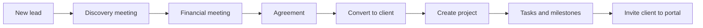

<div align="center">
  
  <h1>Zyma CRM</h1>
  <p><strong>Know every lead. Know where every project stands.</strong></p>
  <p>The internal CRM for Zyma Systems staff and Super Admin: a static web workspace for leads, meetings, clients, projects, tasks and communications, backed by the shared Zyma ASP.NET Core API.</p>

  
  
  
  
</div>

---

## Overview

Zyma CRM is about two things: keeping a clear record of every relationship from first lead to delivered project, and keeping that record internal. It is a standalone frontend for Zyma Systems staff. It is separate from the client-facing Client Portal, and the two meet only through the shared API.

A relationship moves along one path. A **lead** is qualified through two client meetings (Discovery, then Financial), converted to a **client**, linked to a **project**, and broken down into **tasks and milestones**. Communications and follow-ups are logged against the relevant lead, client or project along the way.

The app is plain HTML, CSS and JavaScript with no build step. It is published as static files on GitHub Pages at `crm.zyma.co.za`.

> **Current status:** staff sign-in and leads run against the live API. Clients are wired to the API in the frontend. Contacts, projects, tasks, milestones, meetings, communications and settings are still stored in the browser. See [Integration status](#integration-status) for the exact breakdown.

## What's inside

| Page | Role |
| --- | --- |
| `index.html` | Staff sign-in |
| `forgot-password.html` | Request a password reset email |
| `reset-password.html` | Set a new password from an emailed token |
| `activate-account.html` | Accept an employee invitation and set a password |
| `workspace.html` | The main workspace: dashboard, leads, meetings, clients, contacts, projects, tasks, communications, reports and settings |
| `tasks.html` | Project picker, then a project-specific task board, list and milestone view |
| `employees.html` | Employee directory and invitations (Super Admin) |
| `invite-client.html` | Invite a client contact to the Client Portal |

| Script | Role |
| --- | --- |
| `login.js` | Calls the sign-in endpoint, decodes the JWT claims and stores the session |
| `auth-session.js` | Navigation guard for internal pages; checks token presence and expiry |
| `crm-api.js` | `window.ZymaCrmApi.request(path, options)`: Bearer-token requests to the CRM API, sign-out on `401` |
| `current-user.js`, `workspace-access.js` | Current user and role-based visibility of workspace sections |
| `app.js` | Workspace logic: rendering, the lead pipeline, charts, reports, exports and the API/local data layer |
| `tasks.js` | Task board, list and milestone logic for a selected project |
| `employees.js` | Employee directory, invitations and access status |
| `invite-client.js` | Client invitation form |
| `forgot-password.js`, `account-workflows.js` | Password recovery, reset and account activation |

## Features

- **Lead pipeline:** board and table views, drag-and-drop between stages, search, follow-up dates and overdue flags. Leads are saved to the CRM database when signed in.
- **Lead workspace:** discovery notes, commercial calculations and a Discovery PDF export. These extended fields are kept in the browser until the API stores them.
- **Meetings:** a two-step flow of a Discovery meeting (requirements, goals and constraints) followed by a Financial meeting (pricing, deposit and payment terms), with Microsoft Teams links and notes.
- **Clients and contacts:** a client directory with Active and Inactive filters, contact profiles, and lead-to-client conversion.
- **Projects, tasks and milestones:** project progress, per-project boards and lists, priorities, due dates and overdue counts.
- **Communications:** a searchable log of conversations, outcomes and next actions, with export.
- **Dashboard and reports:** lead pipeline by stage, lead growth trend, sales funnel health, project progress, task status and priority, client portfolio by industry, a needs-attention list, and CSV exports for each report.
- **Roles:** `super_admin`, `employee`, `sales`, `project_manager` and `viewer`. Employee management is shown only to Super Admin.
- **Theme and settings:** dark and light themes, workspace profile, personal preferences and notification settings saved per browser.

## How it fits together

```mermaid
flowchart LR
    subgraph CRM["Zyma CRM (this repo, crm.zyma.co.za)"]
        L1[index.html + login.js] --> S1[auth-session.js<br/>JWT in sessionStorage]
        S1 --> P[workspace.html<br/>tasks.html<br/>employees.html]
        P --> A1[crm-api.js<br/>ZymaCrmApi.request]
        P -. records not yet in the API .-> B[(Browser localStorage)]
    end

    subgraph API["Zyma API (api.zyma.co.za)"]
        R1[POST /api/crm/auth/login]
        R2[/api/crm/leads]
        R3[/api/crm/clients]
        R4[/api/crm/admin/employees]
    end

    PG[(PostgreSQL)]
    Portal[Client Portal<br/>portal.zyma.co.za]

    L1 --> R1
    A1 -->|Bearer token| R2
    A1 -->|Bearer token| R3
    A1 -->|Bearer token| R4
    API --> PG
    Portal --> API
```

The CRM never talks to the database or to the Client Portal directly. The API decides what each audience may see: staff see CRM records, and a client sees only the projects and support records that belong to their organisation.

## Key workflows

1. **Add a lead** and move it through the pipeline stages.
2. **Hold the Discovery meeting**, then the Financial meeting, and record the outcomes.
3. **Convert** the qualified lead to a client.
4. **Create a project** linked to that client.
5. **Open the project** and choose **Manage tasks & milestones**.
6. **Add tasks and milestones** with owners, due dates, priorities and statuses.
7. **Log communications and follow-ups** against the lead, client or project.
8. **Invite the client contact** to the Client Portal from the client record.



## Authentication

- Sign-in calls `POST https://api.zyma.co.za/api/crm/auth/login` with email and password.
- The returned JWT is held in `sessionStorage`, so it lasts for the current tab session and is never written to `localStorage`.
- `auth-session.js` sends unauthenticated or expired sessions back to `index.html`. This is a convenience guard only; the API must enforce authorization on every route.
- `crm-api.js` attaches the Bearer token and returns the user to sign-in after a `401`.
- The signed-in user's role is read from the token claims and used to show or hide sections such as Employee Management.
- Browser sign-in needs the API to allow CORS from `https://crm.zyma.co.za`.
- Because the token is readable by JavaScript, XSS prevention matters. Moving to secure HttpOnly cookies with CSRF protection is the planned hardening step.

## Integration status

| Area | Status |
| --- | --- |
| Staff sign-in | API-backed |
| Leads: list, create, edit, stage change, delete | API-backed (`/api/crm/leads`) for company, contact, email, phone, industry, stage, requirements, estimated value, follow-up date and assignee |
| Lead extras: discovery, pricing, deposit, Zoho subscription, meeting and activity fields | Browser-local, labelled as such in the UI |
| Clients: list | API-backed (`GET /api/crm/clients`) |
| Clients: create and lead-to-client conversion | Wired in the frontend (`POST /clients`, `POST /leads/{id}/convert`); confirm the backend routes before relying on them |
| Employee directory and invitations | Wired in the frontend (`/api/crm/admin/employees`); backend not yet confirmed |
| Password recovery, reset and account activation | Wired in the frontend; need backend routes and email delivery |
| Client invitations | Wired in the frontend (`POST /api/invitations`); needs the API and email service |
| Contacts, projects, tasks, milestones, meetings, communications, settings | Browser-local only |

When the API is not reachable or the user is not signed in, leads and clients fall back to browser-local preview data. Browser storage is not shared between users or devices and is not secure enough for production client data.

## Run the frontend

The repository is static, so any local file server works.

```bash
python3 -m http.server 8080
```

Open `http://localhost:8080/index.html` and sign in. Sign-in needs `https://api.zyma.co.za` to be reachable and to allow your origin through CORS. Browser testing from `https://crm.zyma.co.za` is still the proper check for CORS, session expiry and lead create, edit, stage and delete behaviour.

The API base URL is set in `crm-api.js` and `login.js`, and can be overridden for some pages through `window.ZYMA_CRM_CONFIG.apiBaseUrl`.

**Local preview storage**

- Records not yet held by the API live in `localStorage` under the `zyma-crm-preview-v2` namespace. A new namespace starts empty, so older sample data is not loaded.
- Theme, lead view, settings and lead trend history are also saved per browser.
- Do not enter confidential client data while a module is still browser-local.

## Deployment

The site is published with GitHub Pages. `CNAME` sets the custom domain `crm.zyma.co.za`, and `.nojekyll` makes Pages serve the files as they are. All asset and script references are relative, so the files publish together without a build.

## Shared API

Planned architecture and contracts are documented in:

- [`SHARED-API-ARCHITECTURE.md`](SHARED-API-ARCHITECTURE.md): the CRM, Client Portal, API and PostgreSQL layout, workflows and security requirements
- [`BACKEND-INTEGRATION.md`](BACKEND-INTEGRATION.md): proposed resource routes, data model notes and current integration status
- [`AUTHENTICATION-SETUP.md`](AUTHENTICATION-SETUP.md): authentication, employee administration and invitation requirements

Several of these documents describe planned routes and were written before parts of the frontend were wired up. Where they disagree with this README, check the code and confirm with the API.

## Known limits

- Most CRM modules are still browser-local, so their data is lost if site data is cleared and is invisible to other staff.
- Lead extras such as discovery and pricing fields are not stored by the API yet.
- A lead's owner shows as "Unassigned" in the frontend; the API's assignee is stored but not yet mapped to a name.
- The JWT lives in `sessionStorage`, so each new browser tab session needs a fresh sign-in.
- Client invitations are sent without the Bearer token and need the backend to accept that, or the call needs to be aligned with the other authenticated routes.
- The frontend guard does not protect data. Authentication and authorization must be enforced server-side.

## Repository map

```text
.
├── index.html                  # Staff sign-in
├── forgot-password.html        # Request a password reset
├── reset-password.html         # Token-based password reset
├── activate-account.html       # Accept invitation, set password
├── invite-client.html          # Invite a client contact to the portal
├── workspace.html              # Main CRM workspace
├── tasks.html                  # Project task board and milestones
├── employees.html              # Employee directory and access admin
├── login.js                    # Sign-in and session setup
├── auth-session.js             # Page guard and JWT expiry check
├── crm-api.js                  # ZymaCrmApi.request with Bearer token
├── current-user.js             # Current signed-in user
├── workspace-access.js         # Role-based section visibility
├── app.js                      # Workspace logic and data layer
├── tasks.js                    # Task board and milestone logic
├── employees.js                # Employee directory logic
├── invite-client.js            # Client invitation logic
├── forgot-password.js          # Password recovery request
├── account-workflows.js        # Activation and password reset
├── styles.css                  # Workspace styles
├── tasks.css                   # Task page styles
├── auth.css                    # Sign-in and account page styles
├── assets/                     # Zyma logos and symbols
├── CNAME                       # Custom domain: crm.zyma.co.za
├── .nojekyll                   # Serve files as they are on GitHub Pages
├── BACKEND-INTEGRATION.md      # Proposed API contracts
├── AUTHENTICATION-SETUP.md     # Authentication requirements
└── SHARED-API-ARCHITECTURE.md  # Shared API design
```

---

<div align="center"><sub>Built by Zyma Systems · Zyma CRM</sub></div>
